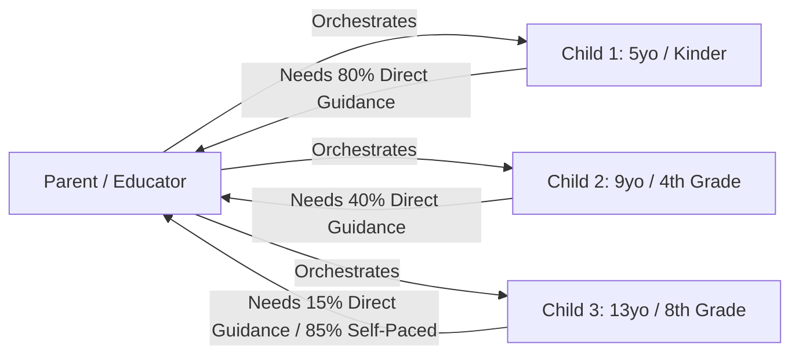
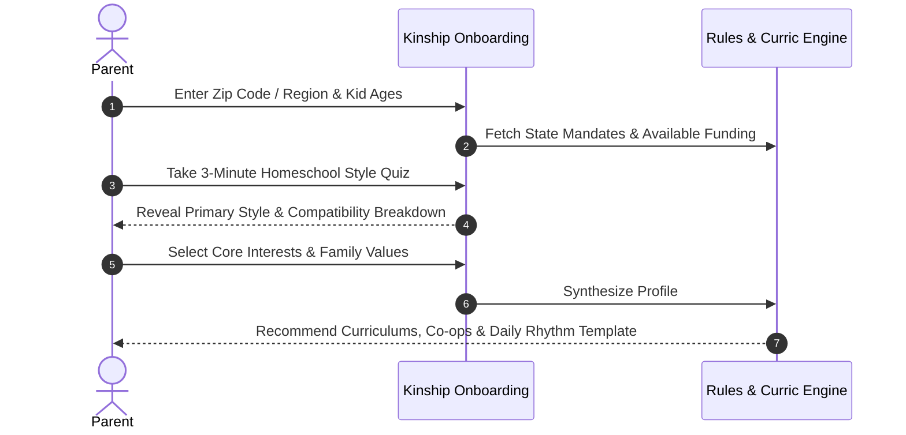
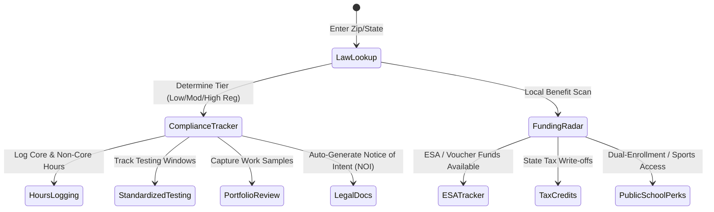
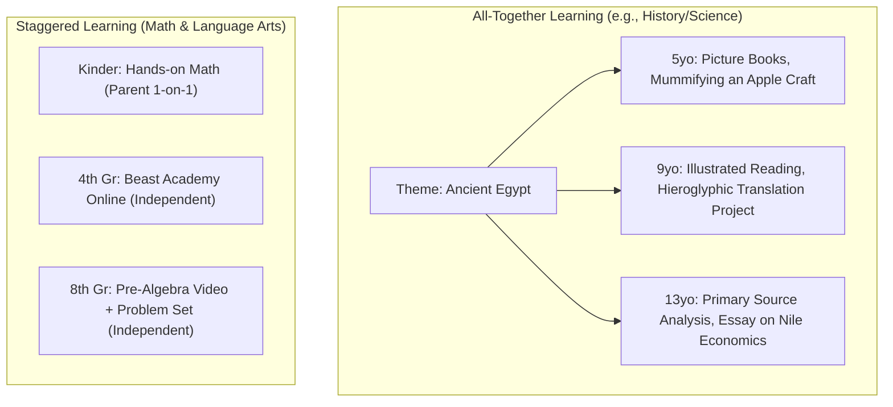
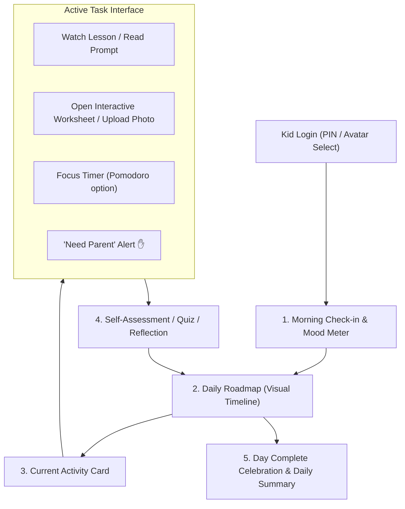
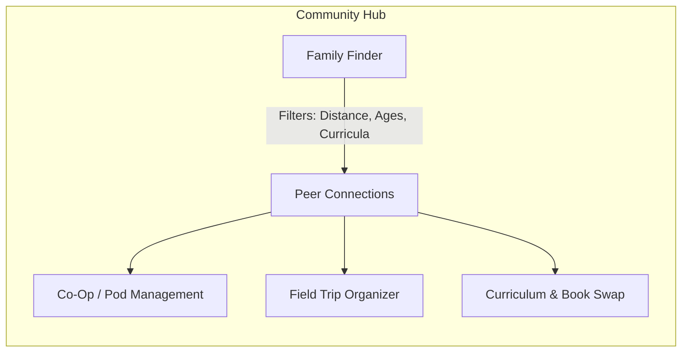
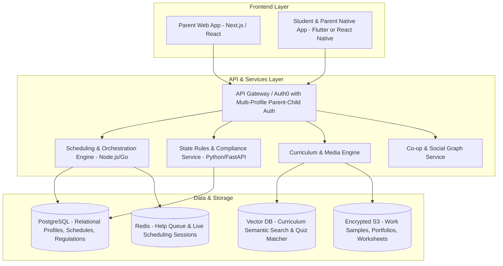

# Kinship: Multi-Child Homeschool Operating System & Community Hub
## Comprehensive Product Blueprint & Architecture Plan

---

## 1. Executive Summary & Vision

**Kinship** is an all-in-one homeschooling platform engineered specifically to solve the "multi-age, multi-pace" dilemma that family educators face. Instead of treating each child as an isolated silo or forcing rigid traditional school schedules into the home, Kinship synchronizes family-wide learning with individual student autonomy.

```
                  ┌────────────────────────────────────────────────────────┐
                  │                 KINSHIP PLATFORM                      │
                  └──────────────────────────┬─────────────────────────────┘
                                             │
         ┌───────────────────┬───────────────┴───────────────┬───────────────────┐
         ▼                   ▼                               ▼                   ▼
┌─────────────────┐ ┌─────────────────┐             ┌─────────────────┐ ┌─────────────────┐
│  State & Local  │ │  Philosophy &   │             │  Multi-Child    │ │  Student-First  │
│   Compliance    │ │ Curriculum Hub  │             │ Schedule Engine │ │   Daily Flow    │
│ (Laws/Stipends) │ │ (Unit Studies)  │             │ (Parent & Kids) │ │ (Tablets/Cards) │
└─────────────────┘ └─────────────────┘             └─────────────────┘ └─────────────────┘
```

### Core Value Pillars
1. **Multi-Kid Synchrony**: Group subjects where kids can learn together (Science, History, Art) while separating skill-based subjects (Math, Phonics/Reading) with staggered 1-on-1 parent attention.
2. **Frictionless Compliance & Benefits**: Location-based legal radar and benefit finder (Notice of Intent generation, attendance/hours logging, portfolio compilation, ESA/Tax Credit tracking).
3. **Values & Philosophy-Driven Onboarding**: Match families to educational philosophies (Charlotte Mason, Classical, Montessori, Unschooling, Nature/Forest School, Faith-based, or Eclectic) and recommend custom setups.
4. **Autonomous Student Experience**: Simple, age-tailored daily learning tracks for children from pre-K to high school.
5. **Hyper-Local & Interest-Based Community**: Real-world field trips, co-op management, and curriculum swaps.

---

## 2. Target User Personas & Daily Realities



| Persona | Needs & Frustrations | Kinship Solution |
| :--- | :--- | :--- |
| **Parent Organizer** | Overwhelmed by juggle; terrified of missing legal obligations; curriculum burnout. | Central schedule with "Parent 1-on-1 Staggering", 1-click legal compliance, automatic portfolio generator. |
| **Younger Child (Ages 4–7)** | Cannot read lengthy task lists; short attention spans; tactile & visual learners. | Icon-based, playful daily flow; audio read-aloud prompts; gamified step completion. |
| **Tween / Middle Child (Ages 8–11)** | Transitioning to semi-independence; easily distracted; likes clear expectations. | Checklist-based day flow, integrated worksheets, scratchpad, timer, and achievement milestones. |
| **Teen / High Schooler (Ages 12–18)** | Needs self-direction, high school credit tracking, transcript generation, dual-enrollment support. | Calendar integration, deep-work timers, subject mastery progress bars, portfolio uploader. |

---

## 3. Module Breakdown & System Specifications

### Module 1: Onboarding, Readiness & Homeschool Style Matcher

The onboarding journey guides families from "Can I actually do this?" to a fully customized first-month roadmap.



#### Feature Specifications:
* **The Homeschool Alignment Quiz**:
  * Evaluates 5 dimensions: Structure vs. Freedom, Book/Textbook vs. Experiential/Project, Secular vs. Faith-Infused, Tech-Integrated vs. Screen-Free/Nature-First, Collective Family Time vs. Individualized Pacing.
  * *Output*: Primary match (e.g., "75% Charlotte Mason + Nature Study, 25% Unit Study") with plain-English explanation of what a typical day looks like.
* **Child Profile Setup**:
  * Name, birthdate, grade level, learning differences (ADHD, Dyslexia, Gifted/2E), passions (e.g., dinosaurs, robotics, creative writing).
  * Independent work tolerance (e.g., "Can work solo for 15 mins").

---

### Module 2: Compliance, Legal & Benefits Engine ("Homeschool Compass")

> [!IMPORTANT]
> Homeschool laws vary drastically by jurisdiction (e.g., Texas requires no reporting, whereas New York and Pennsylvania require detailed quarterly reports, testing, and approval of instructional plans).



#### Key Functional Features:
1. **Notice of Intent (NOI) & Document Generator**:
   * Pre-populated legal templates tailored to county/school district requirements.
   * Digital signatures and exportable PDFs with proof-of-mailing checklist.
2. **Attendance & Subject Hours Counter**:
   * Automatic background logging when kids complete activities.
   * Categorizes hours into Core (Math, ELA, Science, Social Studies) and Non-Core (PE, Fine Arts, Health, Foreign Language).
3. **Digital Portfolio & Evidence Vault**:
   * Mobile snap-and-upload: Take a photo of an offline math worksheet, science diorama, or handwriting sample.
   * Tags evidence by subject, date, and state learning standard.
   * 1-Click "End of Year Evaluator Packet" export.
4. **Benefits & Funding Radar**:
   * **Education Savings Accounts (ESA)** (e.g., Arizona, Utah, Florida, Iowa): Expense tracking, approved vendor tags, receipt storage.
   * **Tax Credits & Deductions**: Itemized homeschooling supply cost reports for tax time.
   * **Public School Resource Access (Tim Tebow Laws)**: Alerts parent if local state allows homeschooled kids to join public school sports, band, STEM labs, or AP testing.

---

### Module 3: Curriculum Architecture & Marketplace

Kinship supports three curriculum models:
1. **Turnkey / Pre-Packaged**: Importing commercial curricula (e.g., Saxon Math, Beast Academy, Story of the World, Blossom & Root, Torchlight, The Good and the Beautiful).
2. **Modular / A La Carte**: Parents mix and match providers per child and per subject.
3. **Custom / Unit Studies**: Parents build their own thematic units that all kids explore together at varying depths.



#### Features:
* **Curriculum Pacing Engine**: Enter "120 lessons in this textbook" and your desired school calendar; Kinship calculates weekly pacing and auto-reschedules missed days without backlog guilt.
* **Co-Op & Micro-School Integration**: Link a class (e.g., "Tuesday 10 AM Co-op Chemistry") so shared homework and group schedules populate directly into the student's week.

---

### Module 4: Dynamic Family Schedule & Orchestration Engine

The biggest failure point of multi-kid homeschooling is **parent contention**—when three kids all need mom/dad's help simultaneously. Kinship's calendar is explicitly built to prevent this.

#### The "Parent Availability Balancing" Algorithm
```
Time Slot   │ Child 1 (5 yo)          │ Child 2 (9 yo)            │ Child 3 (13 yo)
────────────┼─────────────────────────┼───────────────────────────┼───────────────────────────
09:00-09:30 │ 🔴 1-on-1 Phonics with Mom│ 🟢 Reading / Silent Books │ 🟢 Independent Math Video
09:30-10:00 │ 🟢 Lego/Sensory Play    │ 🔴 1-on-1 Math Help w/ Mom│ 🟢 History Essay Writing
10:00-10:30 │ 🟢 Outdoor Free Play    │ 🟢 Typetastic / Coding    │ 🔴 1-on-1 Science Lab Review
10:30-11:15 │ 🔵 Family Unit Study: Botany & Nature Journaling (All Kids + Parent Together)
```
*(Legend: 🔴 Parent Dedicated | 🟢 Solo Independent | 🔵 Group Together)*

#### Smart Calendar Capabilities:
* **"Gentle Bump" Reschedule**: When a field trip or doctor's appointment runs long, tap "Bump Remaining Tasks" to shift them into tomorrow or an upcoming "Flex/Catch-up Friday".
* **Sync with Family Life**: 2-way Google Calendar / Apple Calendar sync for non-school commitments (dentist, swim lessons, music classes).

---

### Module 5: Daily Student Flow (The Child Experience)

The child interface is accessible via web, tablet, or phone, optimized to encourage independence, focus, and a sense of accomplishment.



#### Student UI Highlights:
* **Non-Reader Mode (Ages 4–6)**: Large illustrative icons, color-coded badges, voice instructions with text-to-speech.
* **Interactive Activity Cards**:
  * Built-in digital worksheets with pen/stylus annotation support.
  * Mini-quizzes (flashcards, drag-and-drop checks, audio response recording).
  * Integrated video player (curated YouTube, Vimeo, or internal video embeds with distraction-free framing).
* **The "I Need Help" Button**: Instead of interrupting parents who are helping a sibling, the child clicks the button. It adds them to the parent's "Help Queue" and prompts the child: *"While you wait for Dad, try your 15-minute silent reading or duolingo task!"*

---

### Module 6: Community, Co-ops & Group Activities

Homeschooling thrives on community. Kinship provides a safe, verified network for parents to collaborate and kids to socialize.



#### Features:
1. **Privacy-First Family Matching**:
   * Search nearby families by kid age matches (e.g., "Find families with 8-10 year-olds studying Classical History").
   * Strict privacy: Exact addresses are never shared; geographic radius fuzzing and opt-in private circles.
2. **Co-Op & Group Activity Planner**:
   * Schedule recurring co-ops with group rosters, rotating parent duties, split supplies costs, and group chat.
   * Field trip coordinator: RSVP tracking, bulk ticket discounts, carpool matching.
3. **Curriculum Swap & Classifieds**:
   * List used homeschool textbooks, manipulatives, and lab gear for free or resale within local verified circles.

---

## 4. Technical Architecture & Tech Stack



### Safety & Compliance Safeguards:
* **COPPA & FERPA Compliance**: Kids have sub-accounts under parental guardianship. No direct open internet communication for children under 13 without parent permission.
* **Offline-First Synchronization**: Local SQLite cache on tablets so kids can complete work outside, at the library, or on road trips ("roadschooling") without Wi-Fi.

---

## 5. UI/UX Wireframe Concepts

### A. Parent "Family Flight Deck" (Desktop / Tablet)
```
+------------------------------------------------------------------------------------+
| KINSHIP  [Family: The Miller Crew]       State: Colorado (Moderate Reg)  [Settings]|
+------------------------------------------------------------------------------------+
| [Today's Rhythm]   [Curriculums]   [State Compliance (84/172 Days)]   [Community]  |
+------------------------------------------------------------------------------------+
| DAILY ORCHESTRATION TIMELINE                      | HELP QUEUE (1 waiting)         |
| 09:00 - 10:00 AM                                  | - Leo (Math Worksheet, Pg 42)  |
|                                                   +--------------------------------+
| LEO (5)   | [ Phonics 1-on-1 ] [ Play Dough ]    | STATE COMPLIANCE RADAR         |
|           |   (With You)         (Solo)           | [✓] NOI Submitted (Aug 15)     |
| MAYA (9)  | [ Reading Solo   ] [ Math 1-on-1]    | [✓] 450 / 900 Hours Logged     |
|           |   (Independent)      (With You)       | [!] Vision/Hearing Test Due    |
| NOAH (13) | [ Pre-Algebra Video ] [ Civics Essay] | [!] Order Stanford-10 Test     |
|           |   (Solo)               (Solo)         |                                |
+------------------------------------------------------------------------------------+
```

### B. Child "Daily Adventure" Flow (Tablet View)
```
+------------------------------------------------------------------------------------+
| ☀️ GOOD MORNING, MAYA!          ⭐ 450 Sparks Earned        [Ask Dad for Help ✋]  |
+------------------------------------------------------------------------------------+
| YOUR MISSIONS TODAY (3 of 5 Done)                                                  |
|                                                                                    |
| [✓] 1. 📖 20 Mins Silent Reading (The Secret Garden)           COMPLETED           |
| [✓] 2. 🧮 Beast Academy 4A - Chapter 3 Practice                 COMPLETED           |
|                                                                                    |
| [*] 3. 🔬 Science: Seed Germination Observation                 [ IN PROGRESS ]    |
|        - Take a photo of your bean sprout                                         |
|        - Draw leaf structure in digital sketchbook                                |
|        [ Open Camera / Sketchpad ]       [ Mark Complete ✓ ]                      |
|                                                                                    |
| [ ] 4. 🏛️ Ancient Egypt Unit Study with Noah & Leo (Starts at 11:00 AM)            |
| [ ] 5. 🏃 Outdoor Nature Walk / Bike Ride (30 mins)                                |
+------------------------------------------------------------------------------------+
```

---

## 6. Detailed Implementation & Rollout Roadmap

### Phase 1: MVP ("Foundational Rhythms & Legal Safety") - Weeks 1 to 12
* **Onboarding & Philosophy Quiz**: Core 15-question archetype quiz + family setup.
* **50-State Legal Radar**: Baseline state regulation directory with compulsory ages, required hours, and NOI templates.
* **Multi-Child Schedule Builder**: Manual scheduling with basic parent-busy detection and daily task cards.
* **Child Dashboard**: Minimalist checklist view with upload-photo capability and "Done" celebrations.

### Phase 2: Intelligence & Ecosystem ("Smart Pacing & Co-ops") - Weeks 13 to 24
* **Dynamic Pacing Engine**: Import popular curriculum pacing guides; auto-shift missed days.
* **Interactive Student Worksheets**: In-app PDF annotator, timer, and embedded media player.
* **Benefits & ESA Tracker**: Expense tagging, stipend balancing, receipt upload.
* **Community Hub Alpha**: Local family discovery, zip-code based co-op creation, and group event RSVPs.

### Phase 3: Advanced Portfolio & AI Learning Companion - Weeks 25+
* **AI Portfolio Summarizer**: Auto-generates quarterly and end-of-year narrative progress reports mapped to state learning objectives.
* **Unit Study Generator**: Input family interests (e.g., "Space Exploration") and child ages; automatically generates a 2-week unit study with multi-tier assignments.
* **Curriculum Exchange Marketplace**: Integrated peer-to-peer textbook marketplace with buyer protection.

---

## 7. Open Architectural & Product Decisions

1. **Curriculum Ingestion Strategy**: Should Kinship directly partner with curriculum publishers (licensing content via APIs) or remain content-agnostic (focusing on planning, pacing, and tracking user-owned curriculum)?
2. **Community Verification Standard**: To guarantee child safety in real-world meetups, what tier of parent ID verification (e.g., Stripe Identity, background check integration, or invite-only vouched circles) should be mandated?
3. **Monetization Model**: Freemium model (free compliance + basic calendar, premium subscription for multi-kid balancing algorithm and AI portfolio exports) vs. School/Co-op bulk licensing.
